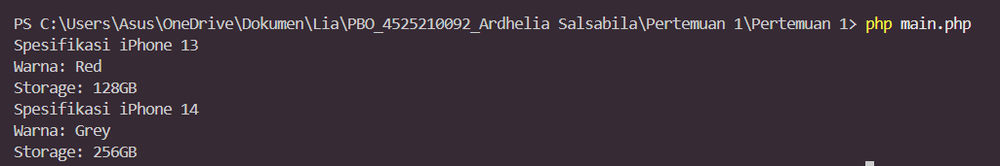

# Pertemuan 1 - Class dan Object

**Mata kuliah:** Pemrograman Berorientasi Objek (PBO)
**Nama:** Ardhelia Sallsabila Al-Bahri | **NIM:** 4525210092
**Bahasa:** PHP

## Tujuan
Memahami cara membuat **class**, membuat **object** dari class tersebut (*instantiation*), serta menerapkan **enkapsulasi** dengan property `private` dan method getter.

## Struktur File
| File | Keterangan |
|------|------------|
| `Iphone.php` | Class `iPhone` dengan property `color` dan `storage`. |
| `main.php` | Membuat object iPhone 13 dan iPhone 14, lalu menampilkan spesifikasinya. |

## Cara Menjalankan
```bash
php main.php
```

## Screenshot Output


## Penjelasan
- **Class** itu seperti *cetakan kue*. `iPhone` adalah cetakannya, sedangkan `$iphone13` dan `$iphone14` adalah kue-kue yang dicetak darinya. Cetakannya sama, tetapi "isi" tiap kue (warna dan storage) bisa berbeda.
- **Constructor** (`__construct`) dipanggil otomatis saat `new iPhone("Red", "128GB")` dijalankan. Tugasnya mengisi nilai awal `color` dan `storage`, seperti pabrik yang langsung mewarnai ponsel dan memasang memori saat dirakit.
- **Property `private`** (`$color` dan `$storage`) tidak bisa diakses langsung dari luar class. Ibaratnya isi brankas: tidak bisa diambil sembarangan, harus lewat "petugas", yaitu method **getter** `getColor()` dan `getStorage()`.
- Pada `main.php`, kedua object memakai class yang sama tetapi menghasilkan output berbeda (Red/128GB dan Grey/256GB), sesuai data yang dikirim ke constructor.
