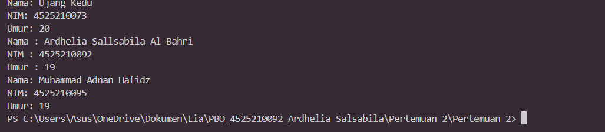

# Pertemuan 2 - Constructor, Getter, dan Setter

**Mata kuliah:** Pemrograman Berorientasi Objek (PBO)
**Nama:** Ardhelia Sallsabila Al-Bahri | **NIM:** 4525210092
**Bahasa:** PHP

## Tujuan
Memahami **constructor dengan nilai default parameter** (pengganti *constructor overloading*), serta penggunaan **getter** dan **setter** untuk mengakses dan mengubah property `private`.

## Struktur File
| File | Keterangan |
|------|------------|
| `Mahasiswa.php` | Class `Mahasiswa` dengan property `nama`, `nim`, `umur`, beserta constructor, getter, setter, dan `tampilkanInfo()`. |
| `Aplikasi.php` | Program utama yang membuat object mahasiswa dengan beberapa cara. |

## Cara Menjalankan
```bash
php Aplikasi.php
```

## Screenshot Output


## Penjelasan
- PHP **tidak mendukung constructor overloading** (beberapa constructor dengan parameter berbeda seperti di Java). Sebagai gantinya, constructor diberi **nilai default** (`"Ujang Kedu"`, `"4525210073"`, `20`). Ibaratnya formulir pendaftaran yang sudah terisi data standar; kalau kita tidak mengisi, data standar itulah yang dipakai.
- Pada `Aplikasi.php` ada tiga skenario:
  1. `new Mahasiswa()` tanpa parameter, sehingga memakai semua nilai default. Hasilnya **Ujang Kedu / 4525210073 / 20** (baris pertama di output).
  2. `new Mahasiswa()` lalu data diubah lewat **setter** (`setNama`, `setNim`, `setUmur`) dan dibaca lewat **getter**. Hasilnya data **Ardhelia Sallsabila Al-Bahri / 4525210092 / 19**.
  3. `new Mahasiswa("Muhammad Adnan Hafidz", "4525210095", 19)` dengan constructor lengkap, sehingga semua data langsung terisi saat object dibuat.
- **Setter** itu seperti petugas yang menerima permintaan ganti data, sedangkan **getter** seperti petugas yang membacakan data. Property `private` tidak disentuh langsung dari luar.
