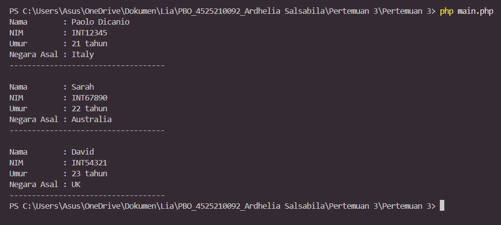

# Pertemuan 3 - Inheritance (Pewarisan) dan Method Overriding

**Mata kuliah:** Pemrograman Berorientasi Objek (PBO)
**Nama:** Ardhelia Sallsabila Al-Bahri | **NIM:** 4525210092
**Bahasa:** PHP

## Tujuan
Memahami **inheritance** (`extends`), **overriding** method dari parent class, serta constructor dengan **nullable type** dan **named argument** pada class `MahasiswaInternational`.

## Struktur File
| File | Keterangan |
|------|------------|
| `MahasiswaInternational.php` | Class mahasiswa internasional (nama, NIM, umur, negara asal) dengan constructor default, getter, setter, dan `tampilkanInfo()`. |
| `main.php` | Program utama yang membuat 3 object `MahasiswaInternational` dengan cara berbeda. |
| `Mahasiswa.php` | Class `Mahasiswa` sebagai parent class (nama, NIM, umur). |
| `BangunDatar.php` | Parent class dengan method `luas()` dan `keliling()`. |
| `Lingkar.php`, `Persegi.php`, `Segitia.php` | Class turunan `BangunDatar` (`Lingkaran`, `Persegi`, `Segitiga`). |
| `App.php` | Program yang memakai class bangun datar untuk mendemonstrasikan inheritance dan overriding. |

## Cara Menjalankan
```bash
php main.php
```

## Screenshot Output


## Penjelasan
### 1. Mahasiswa International (`main.php`)
Tiga object dibuat dengan tiga cara berbeda:
- **Tanpa parameter**, lalu semua data diisi lewat setter (Paolo Dicanio, Italy).
- **Named argument** (`nama:`, `nim:`, `negaraAsal:`) dan umur diisi belakangan lewat `setUmur()` (Sarah, Australia). Named argument seperti menulis nama kolom di formulir, jadi urutan dan kolom yang dilewati tidak membingungkan.
- **Empat parameter lengkap** (David, UK).

Tipe `?string` dan `?int` artinya nilainya boleh `null` (kosong). Pada `tampilkanInfo()`, operator `??` menampilkan `-` kalau data masih kosong.

### 2. Inheritance Bangun Datar (`App.php`)
- `BangunDatar` adalah **parent class** berisi method umum `luas()` dan `keliling()`. Class `Lingkaran`, `Persegi`, dan `Segitiga` adalah **anak** yang mewarisinya lewat `extends`. Seperti anak yang mewarisi sifat orang tuanya, tetapi bisa punya cara sendiri.
- `Lingkaran` dan `Persegi` meng-**override** kedua method dengan rumus masing-masing (`M_PI * r * r`, `sisi * sisi`, dan seterusnya).
- `Segitiga` hanya meng-override `luas()`. Saat `$sg->keliling()` dipanggil, yang berjalan adalah `keliling()` milik parent (`BangunDatar`), karena anak tidak punya versinya sendiri.

> Screenshot di atas adalah hasil `main.php` (Mahasiswa International).
