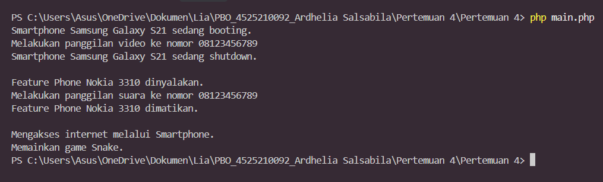

# Pertemuan 4 - Polimorfisme

**Mata kuliah:** Pemrograman Berorientasi Objek (PBO)
**Nama:** Ardhelia Sallsabila Al-Bahri | **NIM:** 4525210092
**Bahasa:** PHP

## Tujuan
Memahami **polimorfisme**: satu pemanggilan method yang sama menghasilkan perilaku berbeda tergantung jenis object-nya, serta penggunaan `instanceof` untuk mengakses method khusus.

## Struktur File
| File | Keterangan |
|------|------------|
| `Handphone.php` | Parent class dengan property `merk`, `model` (`protected`) dan method `nyalakan()`, `matikan()`, `telepon()`. |
| `SmartPhone.php` | Class `Smartphone` (turunan `Handphone`) dengan method khusus `aksesInternet()`. |
| `FeaturePhone.php` | Class `FeaturePhone` (turunan `Handphone`) dengan method khusus `mainGameSnake()`. |
| `main.php` | Menyimpan kedua jenis ponsel dalam satu array lalu memanggil method lewat perulangan. |

## Cara Menjalankan
```bash
php main.php
```

## Screenshot Output


## Penjelasan
- `Smartphone` dan `FeaturePhone` sama-sama **mewarisi** `Handphone` dan **meng-override** `nyalakan()`, `matikan()`, dan `telepon()` dengan versinya masing-masing.
- Property `protected` bisa dipakai oleh class turunan tetapi tetap tidak bisa diakses dari luar class, seperti barang keluarga yang boleh dipakai anggota keluarga tetapi tidak oleh orang asing.
- Pada `main.php`, kedua object dimasukkan ke satu array `$daftarHandphone`. Di dalam `foreach`, kode yang dipanggil sama (`$hp->nyalakan()`, `$hp->telepon(...)`), tetapi hasilnya berbeda: Smartphone *booting* dan melakukan panggilan **video**, sedangkan Feature Phone *dinyalakan* dan melakukan panggilan **suara**. Itulah **polimorfisme**, mirip tombol "play" yang sama tetapi memutar lagu di pemutar musik dan memutar video di pemutar video.
- Method khusus (`aksesInternet()` dan `mainGameSnake()`) hanya dimiliki class tertentu, jadi dicek dulu dengan `instanceof` sebelum dipanggil: kalau object-nya `Smartphone` akses internet, kalau `FeaturePhone` main Snake.
