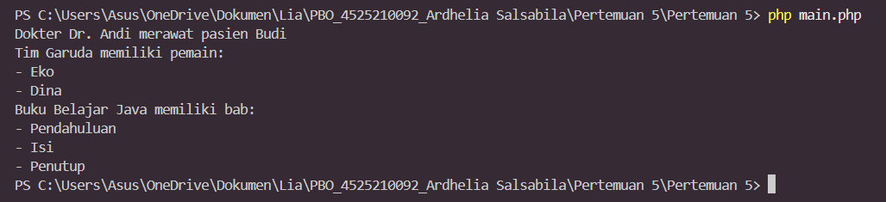

# Pertemuan 5 - Asosiasi, Agregasi, dan Komposisi

**Mata kuliah:** Pemrograman Berorientasi Objek (PBO)
**Nama:** Ardhelia Sallsabila Al-Bahri | **NIM:** 4525210092
**Bahasa:** PHP

## Tujuan
Memahami tiga jenis hubungan antar object: **asosiasi**, **agregasi**, dan **komposisi**.

## Struktur File
| File | Keterangan |
|------|------------|
| `Dokter.php`, `Pasien.php` | Contoh **asosiasi**. |
| `Pemain.php`, `Tim.php` | Contoh **agregasi**. |
| `Bab.php`, `Buku.php` | Contoh **komposisi**. |
| `main.php` | Program utama yang menjalankan ketiga contoh. |

## Cara Menjalankan
```bash
php main.php
```

## Screenshot Output


## Penjelasan
| Hubungan | Contoh | Penjelasan |
|----------|--------|------------|
| **Asosiasi** | `Dokter` dan `Pasien` | Dua object yang saling berhubungan tetapi berdiri sendiri. Dokter hanya "merawat" pasien lewat method `merawat(Pasien $pasien)`. Seperti dokter dan pasien di rumah sakit: keduanya ada tanpa bergantung satu sama lain. |
| **Agregasi** | `Tim` dan `Pemain` | Tim *memiliki* pemain, tetapi pemain dibuat di luar lalu dimasukkan ke tim (`new Tim("Garuda", [$pemain1, $pemain2])`). Kalau tim bubar, pemain tetap ada. Seperti anggota klub: klub bubar, orangnya tetap ada. |
| **Komposisi** | `Buku` dan `Bab` | Bab dibuat **di dalam** `Buku` (`tambahBab()`), jadi hidup-matinya bergantung pada buku. Saat `$buku = null`, babnya ikut hilang. Seperti bab dalam buku: tidak ada buku, tidak ada babnya. |

Pada output, baris pertama menunjukkan Dr. Andi merawat Budi (asosiasi), lalu daftar pemain Tim Garuda (agregasi), lalu daftar bab buku "Belajar Java" (komposisi).
