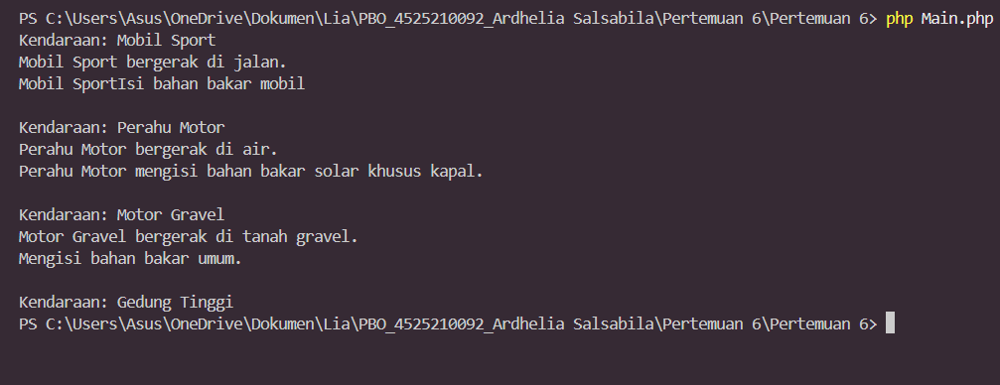

# Pertemuan 6 - Abstract Class, Interface, dan Trait

**Mata kuliah:** Pemrograman Berorientasi Objek (PBO)
**Nama:** Ardhelia Sallsabila Al-Bahri | **NIM:** 4525210092
**Bahasa:** PHP

## Tujuan
Memahami **abstract class**, **interface** (kontrak yang harus dipenuhi class), dan **trait** sebagai pengganti *default method* interface di Java.

## Struktur File
| File | Keterangan |
|------|------------|
| `Vehicle.php` | **Abstract class** induk dengan property `name` dan method `showInfo()`. |
| `Movable.php` | **Interface** berisi kontrak `move()`. |
| `Fuelable.php` | **Interface** berisi kontrak `refuel()`. |
| `FuelableTrait.php` | **Trait** berisi implementasi bawaan `refuel()`. |
| `Car.php` | Turunan `Vehicle`, mengimplementasikan `Movable` dan `Fuelable`. |
| `Boat.php` | Turunan `Vehicle`, mengimplementasikan `Movable` dan `Fuelable`. |
| `Motor.php` | Turunan `Vehicle`, memakai `FuelableTrait` untuk `refuel()` bawaan. |
| `Building.php` | Turunan `Vehicle` tanpa interface (tidak bisa bergerak dan tidak butuh bahan bakar). |
| `Main.php` | Program utama yang membuat dan menjalankan semua object. |

## Cara Menjalankan
```bash
php Main.php
```

## Screenshot Output


## Penjelasan
- **Abstract class** `Vehicle` adalah kerangka umum yang tidak bisa dibuat objeknya langsung (tidak bisa `new Vehicle()`), hanya diwariskan. Seperti konsep "kendaraan" yang baru nyata saat berwujud mobil, perahu, atau motor.
- **Interface** adalah *kontrak*. Class yang `implements Movable` wajib punya method `move()`. Seperti syarat SIM: siapa pun yang mau mengemudi harus memenuhinya.
- **Car** dan **Boat** menulis `move()` dan `refuel()` sendiri (*override*), sehingga hasilnya berbeda: mobil bergerak di jalan, perahu di air dan memakai solar khusus kapal.
- **Motor** tidak menulis `refuel()` sendiri. PHP tidak punya *default method* di interface seperti Java, jadi dipakai **trait** (`use FuelableTrait`) yang menyediakan `refuel()` bawaan: "Mengisi bahan bakar umum." Trait itu seperti paket fitur siap pakai yang tinggal ditempelkan ke class.
- **Building** hanya mewarisi `Vehicle` tanpa interface apa pun, sehingga hanya bisa `showInfo()`. Kalau `move()` atau `refuel()` dipanggil di Building akan error (sudah ditandai sebagai komentar di `Main.php`), dan ini sesuai dengan output yang hanya menampilkan "Kendaraan: Gedung Tinggi".
